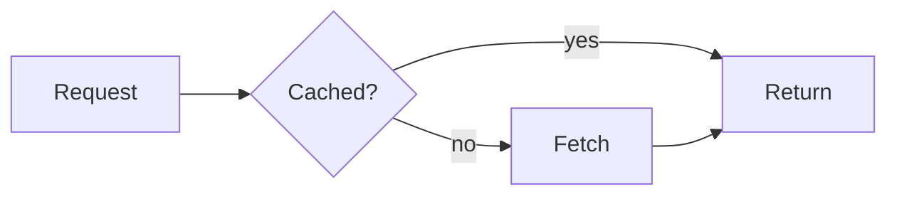

# Plan 005: Render Mermaid diagrams while their fence is still streaming (opt-in), keeping the last good diagram on screen

> **Executor instructions**: Follow this plan step by step. Run every
> verification command and confirm the expected result before moving to the
> next step. If anything in the "STOP conditions" section occurs, stop and
> report. Do not improvise. When done, update the status row for this plan
> in `.agents/.plans/competitive-followups/README.md`, unless a reviewer
> dispatched you and told you they maintain the index.
>
> **Prerequisites**: plans `003-mermaid-engine-contract.md` and
> `004-pele-mermaid-engine.md` must be DONE and merged into your base. Check:
> `grep -n "export interface MermaidEngine" src/lib/extensions/mermaid/mermaidEngine.ts && test -f src/lib/extensions/mermaid-pele/createPeleEngine.ts && echo ok`
> → the interface line and then `ok`. Otherwise STOP.
>
> **Drift check (run first)**:
> `git diff --stat 8a366c0..HEAD -- src/lib/extensions/mermaid/markedMermaid.ts src/lib/extensions/mermaid/markedMermaid.test.ts src/lib/utils/incremental-parser.test.ts src/routes/test/`
> `markedMermaid.ts` should be unchanged since `bdebe69`. If it changed,
> compare it with the excerpt below. `MermaidRenderer.svelte` is expected to
> match plan 003's Step 6 shape. Read it and confirm before Step 4.
>
> **Revision 2026-10-28**: Git workflow re-pointed to the shared digest branch `chore/competitive-intel-2026-10-28` (operator's standing rule: digest follow-ups ship as one PR). The reviewer owns git. No change to scope or steps.
>
> **Revision 2026-10-28 (2)**: pre-flight after plans 003 and 004 landed. (a) pele is installed at **1.10.1**, not 1.12.0, because of the 2-day `minimumReleaseAge` policy. Use whatever `package.json` pins, and do not bump it. (b) The prerequisites are on the batch branch at `8a366c0`, so `Planned at` was re-stamped. (c) Before any `pnpm test:e2e`, make sure nothing listens on port 4173 (`lsof -nP -iTCP:4173 -sTCP:LISTEN`). A stale preview there makes every test fail with CONNECTION_REFUSED.

## Status

- **Priority**: P2
- **Effort**: M
- **Risk**: MED. It touches the streaming tokenizer path, so tail-window parity must hold.
- **Depends on**: 003 (edits the `MermaidRenderer.svelte` that 003 rewrites) and
  004 (the E2E demo needs a synchronous engine. With async mermaid.js, live
  rendering works but is not the point)
- **Wave**: 3
- **Category**: direction (competitive gap)
- **Planned at**: commit `8a366c0`, 2026-10-28 (re-stamped; originally `bdebe69`)
- **Ticket**: HUM-72 (`gap-lightweight-mermaid-engine`), part 3 of 3. After this plan, the gap can move to `closed_gaps`.

## Why this matters

In an AI chat, a Mermaid diagram arrives line by line. Today our
`markedMermaid()` tokenizer only matches a **closed** fence. While the fence is
open, marked renders it as a plain code block. The diagram appears only when
the closing fence lands, all at once. svelte-streamdown 5.0.0 draws diagrams
**while they stream**: a half-typed last line is dropped, and the last good
diagram stays up while the next line is invalid. With a synchronous engine
(pele, plan 004) we can do the same. This plan adds it as an **opt-in**
tokenizer option, so default behavior is unchanged.

## Current state

- `src/lib/extensions/mermaid/markedMermaid.ts` (the tokenizer, unchanged since `bdebe69`):
    ````ts
    export function markedMermaid(): MarkedExtension {
        const ext: MarkedExtension = {
            extensions: [
                {
                    name: 'mermaid',
                    level: 'block',
                    start(src: string) {
                        return src.match(/```mermaid/)?.index
                    },
                    tokenizer(src: string) {
                        const match = src.match(/^```mermaid\n([\s\S]*?)```/)
                        if (match) {
                            return { type: 'mermaid', raw: match[0], text: match[1].trim() }
                        }
                    }
                }
            ]
        }
        return tailWindowSafeExtension(ext)
    }
    ````
    `tailWindowSafeExtension` (in `src/lib/utils/tail-window.ts`) marks the
    tokenizer as "block-anchored and stateless — it inspects only `src` from
    the current position". The streaming `IncrementalParser` then re-lexes only
    the tail, so the token for the trailing open fence is recomputed on every append.
- `markedMermaid.test.ts:120` pins today's default:
  `'should return undefined for unclosed mermaid fence'`. It must keep passing
  unmodified, because the new behavior is opt-in.
- Tokens are spread into renderer props. `src/lib/Parser.svelte:363` renders
  `{...token}`, so any extra token field (for example `closed`) arrives as a
  prop on `MermaidRenderer` and on a `mermaid` snippet override.
- `MermaidRenderer.svelte`, after plan 003, keeps `result: MermaidRenderResult | null`,
  renders `loading` when `result` is null, renders `error` when
  `result.error !== undefined`, and otherwise renders `{@html result.svg}`. An
  `$effect` calls `resolved.render(text, { dark, lightTheme, darkTheme })`
  after mount and drops stale async results with `renderCounter`.
- Parity tests: `src/lib/utils/incremental-parser.test.ts` →
  `describe('Extension streaming parity')` (around line 1196) contains
  `'streams a mermaid fence split across chunks to the same tokens as a one-shot lex'`
  (around line 1249). It uses the local helpers `createExtensionOptions([...])`,
  `streamThrough(parser, chunks, options)` and
  `parseAndCacheModule.lexAndClean(source, options, false)`.
  **Build a fresh options object for every parser.** marked's `Lexer` mutates
  the options object it receives, and a shared object silently disables the
  tail window, which makes parity tests pass for the wrong reason (pinned by
  `incremental-parser.options-pollution.test.ts`).
- Imperative streaming patterns: `src/routes/test/imperative-streaming/+page.svelte`
  (`writeChunk`) and its E2E test `tests/imperative-streaming.test.ts`.
  `tests/mermaid.test.ts` is the E2E pattern for diagrams.

## Design (decided, implement exactly)

1. `markedMermaid(options?: MarkedMermaidOptions)`, where
   `interface MarkedMermaidOptions { /** Emit tokens for a still-open fence at the end of input. Default false. */ renderOpenFences?: boolean }`.
2. The closed-fence path is byte-identical to today. Tokens have no new fields.
3. When `renderOpenFences` is true and the closed regex does not match, try
   `/^```mermaid\n([\s\S]*)$/` (the fence runs to the end of input). On a match:
    - `raw` = the whole match (marked must consume to end of input)
    - `text` = only **complete lines**: `body.slice(0, body.lastIndexOf('\n') + 1).trim()`.
      A half-typed last line is dropped. Because of this, `text` changes only
      when a line completes, which also throttles re-renders.
    - `closed: false`
4. `MermaidRenderer` gets prop `closed?: boolean` (default `true`). When `closed === false`:
    - if `text` is empty, do not call the engine; show the loading placeholder
    - if the engine returns `{ error }`, keep showing the **last successful
      svg** if there is one; otherwise keep the loading placeholder. Never show
      the error box for an open fence.
    - When the fence closes (`closed` becomes `true`/absent), behave exactly as
      today: an error is shown as an error.

## Commands you will need

| Purpose        | Command                                                              | Expected                 |
| -------------- | -------------------------------------------------------------------- | ------------------------ |
| Unit (mermaid) | `pnpm test:only src/lib/extensions/mermaid`                          | all pass                 |
| Unit (parity)  | `pnpm test:only src/lib/utils/incremental-parser.test.ts`            | all pass                 |
| Unit (all)     | `pnpm test`                                                          | all pass, coverage ≥ 90% |
| Typecheck      | `pnpm check`                                                         | exit 0                   |
| E2E (new)      | `pnpm test:e2e tests/mermaid-streaming.test.ts`                      | all pass                 |
| E2E (mermaid)  | `pnpm test:e2e tests/mermaid.test.ts tests/mermaid-snippets.test.ts` | all pass                 |
| Lint / format  | `trunk fmt && trunk check`                                           | no new issues            |

## Scope

**In scope**:

- `src/lib/extensions/mermaid/markedMermaid.ts` and `markedMermaid.test.ts` (add tests only; do not edit existing ones)
- `src/lib/extensions/mermaid/MermaidRenderer.svelte`
- `src/lib/extensions/mermaid/MermaidRenderer.open-fence.test.ts` (create)
- `src/lib/extensions/mermaid/index.ts` (export `type MarkedMermaidOptions`) and `src/lib/extensions/index.ts` (same type re-export)
- `src/lib/utils/incremental-parser.test.ts` (add parity tests in `describe('Extension streaming parity')` only)
- `src/routes/test/mermaid-streaming/+page.svelte` (create, dev/E2E route)
- `tests/mermaid-streaming.test.ts` (create)
- `README.md`: Mermaid section only

**Out of scope**:

- `src/lib/utils/incremental-parser.ts` and `tail-window.ts`. If parity fails,
  the fix belongs in the tokenizer, not the parser. Otherwise STOP.
- `src/lib/extensions/mermaid-pele/*` and `mermaidEngine.ts`. The contract does not change.
- Turning `renderOpenFences` on by default. That is a later product decision.
- Any change to existing tests.

## Git workflow

- All work from this batch integrates onto the existing branch
  `chore/competitive-intel-2026-10-28` (the 2026-10-28 digest's state.json
  branch). Digest follow-ups ship as one PR, per the operator's standing rule.
- The dispatching reviewer (guard) owns git. Do NOT create branches, commit,
  push, or open PRs yourself.
- For reference, commit messages use Conventional Commits, e.g. `docs(compare): …` / `feat(mermaid): …`.

## Steps

### Step 1: Red tokenizer tests

Add to `markedMermaid.test.ts`, inside a new `describe('renderOpenFences')`.
Use the file's existing `getTokenizerDef()` helper, extended to accept options
if needed; adapt the helper without changing existing call sites.

1. with `{ renderOpenFences: true }`, `'```mermaid\ngraph TD\n    A --> B\n    B --'`
   → token `{ type: 'mermaid', raw: <whole src>, text: 'graph TD\n    A --> B', closed: false }`
2. same option, closed fence → token **without** a `closed` key (`expect('closed' in token).toBe(false)`)
3. same option, `'```mermaid\n'` → token with `text: ''`, `closed: false`
4. same option, `'```mermaid\ngraph TD'` (no complete line yet) → `text: ''`, `closed: false`
5. without options → unclosed fence still returns `undefined` (default unchanged)

**Verify**: `pnpm test:only src/lib/extensions/mermaid/markedMermaid.test.ts` → cases 1–4
FAIL (`undefined` token, or a type error on the options argument), and case 5
plus every pre-existing test passes.

### Step 2: Implement the tokenizer option

Implement design points 1–3 in `markedMermaid.ts`. Export
`interface MarkedMermaidOptions` with a JSDoc that explains the trade-off
(partial diagrams render mid-stream, and are best paired with a synchronous
engine such as `extensions/mermaid-pele`). Update the function's JSDoc
`@example` to show the option. Keep the `tailWindowSafeExtension(ext)` wrap.
The tokenizer still inspects only `src` from the current position, so the
promise stays true.

**Verify**: `pnpm test:only src/lib/extensions/mermaid/markedMermaid.test.ts` → all pass.

### Step 3: Streaming parity with open fences

In `incremental-parser.test.ts`, inside `describe('Extension streaming parity')`, add:

1. `'streams an open mermaid fence with renderOpenFences to the same tokens as a one-shot lex at every append'`.
   Use the same source and 5-char chunking as the existing mermaid parity test,
   with `createExtensionOptions([markedMermaid({ renderOpenFences: true })])`.
   After **each** `parser.update(accumulated)`, compare `.tokens` with
   `parseAndCacheModule.lexAndClean(accumulated, freshOptions(), false)`. Build
   a fresh options object for the one-shot lex each time, never the parser's
   object.
2. `'keeps the tail window enabled with renderOpenFences'`: following the
   `'marks katex, alert, and mermaid as tail-safe'` test,
   `asInternalParser(new IncrementalParser(createExtensionOptions([markedMermaid({ renderOpenFences: true })]))).tailWindowDisabled`
   is `false`.

**Verify**: `pnpm test:only src/lib/utils/incremental-parser.test.ts` → all pass.
If test 1 fails at an intermediate append, STOP and report the first
diverging prefix. Do not edit the parser.

### Step 4: Red renderer tests

Create `MermaidRenderer.open-fence.test.ts`. Pass a sync stub engine through
the `engine` prop. Model it on plan 003's `MermaidRenderer.engine.test.ts`.
Cases:

1. `closed: false` with `text: ''` → loading placeholder, and the engine is not called
2. `closed: false`, the engine returns svg A, then `rerender({ text: 'bad', closed: false })`
   with the engine returning `{ error }` → svg A is still shown, and
   `[data-testid="mermaid-error"]` is absent
3. `closed: false`, the first render errors (no previous svg) → loading placeholder, no error box
4. after case 2's state, `rerender({ text: 'bad', closed: true })` → error box shown (today's behavior)
5. no `closed` prop with an erroring engine → error box (default unchanged)

**Verify**: `pnpm test:only src/lib/extensions/mermaid/MermaidRenderer.open-fence.test.ts`
→ cases 1–3 FAIL. Cases 4 and 5 may pass already.

### Step 5: Implement the renderer behavior

In `MermaidRenderer.svelte`, add `closed = true` to the props. Keep a
`lastSvg` (`$state('')`), set whenever a result has `svg`. Inside the `$effect`:
when `closed === false && text === ''`, set `result = null` and return without
calling the engine. Derive what to display:

- `result?.svg` → that svg
- `result?.error` and `!closed` → `lastSvg` if non-empty, otherwise loading
- `result?.error` and `closed` → error box
- `result` null → `lastSvg` if `!closed` and non-empty, otherwise loading

Keep the `data-testid`s and markup unchanged. Keep `MermaidRenderer.test.ts`
and plan 003's engine tests passing unmodified.

**Verify**: `pnpm test:only src/lib/extensions/mermaid` → all pass.

### Step 6: Exports

Export `type MarkedMermaidOptions` from `mermaid/index.ts` and from the barrel
`extensions/index.ts` (type-only, so it is barrel-safe).

**Verify**: `pnpm check` → exit 0, and `pnpm test:only src/lib/extensions` → all pass.

### Step 7: E2E demo route and test

Create `src/routes/test/mermaid-streaming/+page.svelte`. It renders
`SvelteMarkdown` with `extensions={[markedMermaid({ renderOpenFences: true })]}`,
`renderers={{ mermaid: MermaidRenderer }}`, and a pele engine
(`createPeleEngine({ diagrams: [flowchart] })` passed via `setMermaidEngine`).
A "Stream" button writes this source one line per 50 ms with `writeChunk`
(model on `imperative-streaming/+page.svelte`):

````text
Here is the flow:



Done.
````

Expose `data-testid="mermaid-streaming-page"` and a `data-testid="stream-done"` marker when finished.

Create `tests/mermaid-streaming.test.ts` (model on `tests/mermaid.test.ts`):

1. click Stream. A `[data-testid="mermaid-diagram"] svg` becomes visible
   **before** `stream-done` appears. Poll for the svg and assert that
   `stream-done` is not yet attached at that moment.
2. during the whole stream, `[data-testid="mermaid-error"]` never appears.
   Before clicking, register a `MutationObserver` with `page.evaluate` that
   sets `window.__sawMermaidError = true` if one is ever added. After the
   stream, assert it is `undefined`.
3. after `stream-done`, exactly one diagram svg is present.

**Verify**: `pnpm test:e2e tests/mermaid-streaming.test.ts` → all pass on all
configured browsers. If WebKit or Firefox flake on test 1's timing, increase
the per-line delay. Do not drop the assertion.

### Step 8: Document it

`README.md`, Mermaid section: add `#### Live diagrams while streaming`. Include:

- the opt-in `markedMermaid({ renderOpenFences: true })`
- that complete lines render as they arrive, a half-typed line is skipped, and
  the last good diagram stays visible while the next line is incomplete or invalid
- the recommendation to pair it with the pele engine. With async mermaid.js
  it works, but each completed line triggers a full async render.
- snippet overrides receive `closed` (`false` while open)

### Step 9: Full gate

```bash
pnpm check
pnpm test
pnpm package && pnpm test:tree-shaking
pnpm test:e2e tests/mermaid.test.ts tests/mermaid-snippets.test.ts tests/mermaid-streaming.test.ts
trunk fmt && trunk check
```

**Verify**: all exit 0, and coverage stays ≥ 90%.

## Test plan

- This extends existing behavior behind an opt-in flag. The red tests are
  Step 1 (tokenizer cases 1–4) and Step 4 (renderer cases 1–3). They fail
  against current code, and the default-unchanged cases (Step 1 case 5,
  Step 4 cases 4–5) pin back-compat.
- Parity at **every** append (Step 3) is the key safety net for the tail-window promise.
- E2E (Step 7) proves the user-visible claim: the diagram appears before the
  fence closes, with no error flash.

## Done criteria

- [ ] `git diff bdebe69 -- src/lib/extensions/mermaid/MermaidRenderer.test.ts` is empty, and no pre-existing test in `markedMermaid.test.ts` was changed (`git diff` shows additions only in that file)
- [ ] `pnpm test` exits 0. Coverage ≥ 90%. The new tokenizer, parity, and renderer tests pass.
- [ ] `pnpm test:e2e tests/mermaid-streaming.test.ts` exits 0
- [ ] `pnpm check` exits 0. `pnpm package && pnpm test:tree-shaking` exits 0.
- [ ] `grep -n "renderOpenFences" README.md src/lib/extensions/mermaid/markedMermaid.ts` matches in both
- [ ] `trunk check` reports no new issues
- [ ] Only in-scope files changed. Plan index status row updated.

## STOP conditions

- Prerequisites 003 or 004 are missing.
- Parity fails at an intermediate append (Step 3), or the tail window turns off.
- Making the renderer behave requires changing `MermaidEngine` or plan 003's existing tests.
- The E2E diagram cannot appear before `stream-done` even with a 200 ms
  per-line delay. That suggests streaming updates aren't reaching the
  tokenizer as expected.

## Maintenance notes

- After this lands, the nightly digest can move `gap-lightweight-mermaid-engine`
  to `closed_gaps`, and the compare page's `Diagrams (Mermaid)` row can
  mention live streaming diagrams. That is a separate docs change; get a
  human sign-off on the claim first.
- Making `renderOpenFences` the default is a behavior change for every
  consumer (open fences stop rendering as code). Consider it for a major
  version only.
- A reviewer should check three things. `text` for open fences must contain
  complete lines only (this is the throttle). The closed-fence token shape
  must be byte-identical. The parity test must build a fresh options object
  per lex.
